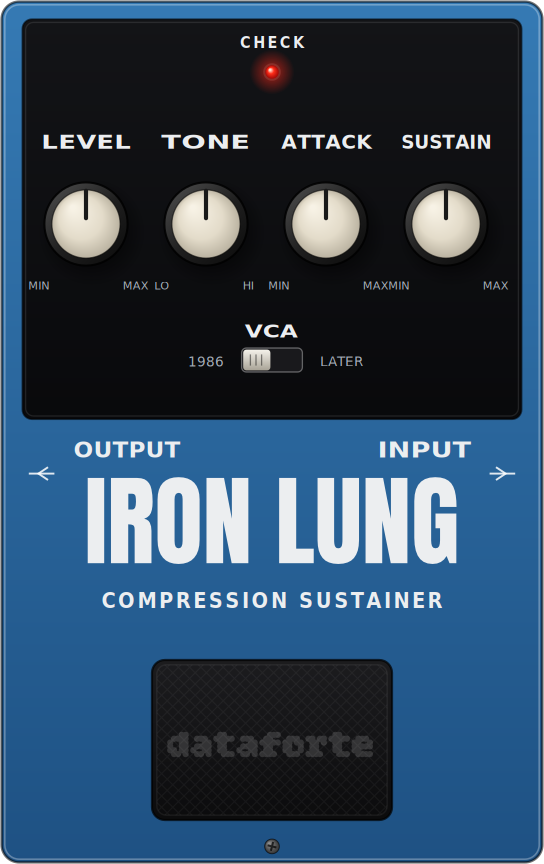

# Iron Lung — a 1986 VCA compression sustainer

<p align="center"></p>

Iron Lung is an LV2/VST3/CLAP/JACK emulation of the **1986 BOSS CS-3
Compression Sustainer**, the first version with the NEC `uPC1252H2`
(DBX 1252) voltage-controlled amplifier. It is a hard-knee, fixed-threshold,
high-ratio compressor built around a current-mode VCA: an op-amp input
buffer, a VCA with a 8.8 kHz I/V pole, an active treble cut/boost tone
stage, a discrete class-A output buffer, and a full-wave transistor
rectifier driving the 4.7 µF control capacitor.

The DSP is written in [Faust](https://faust.grame.fr) and built with
[DPF](https://github.com/DISTRHO/DPF); the scalable cairo GUI and the
modgui are rendered from the same artwork. Everything is our own
work: the pedal is only named in the documentation as the emulated circuit.

## Controls

All four knobs are **pot positions, 0–10**, as on the pedal (0 = fully
counter-clockwise, 10 = fully clockwise; noon = 5), so published
clock-face settings map directly.

| Control | Function | Circuit |
|---|---|---|
| LEVEL | Output volume | VR1 50 kA log, between the tone stage and the Q4/Q1 buffers |
| TONE | Treble cut/boost, flat at the centre | VR2 20 kB between the two IC2b inputs, wiper through R1 4.7 k + C1 27 n to ground |
| ATTACK | Trades attack against release: CCW = quick attack/long release, CW = slower attack/shorter release | VR3 250 kC rheostat in series with R2 22 k, charging C8 4.7 µF from 9 V |
| SUSTAIN | Compression amount and static gain | VR4 20 kB divider (R4 4.7 k to 9 V, R3 22 k to ground); IC4b buffers it and D6 clamps C8 at that level |
| VCA | `1986` (the original part) or `later` (the later production VCA) | see *Deviations* |

Bypass is the footswitch (the black tread plate), with a 10 ms crossfade.

## Signal path

Designators are those of the 1986 BOSS service-notes schematic (ET board
7523252000, VR board 7523254000); the Aion FX **Oracle** build document
(2022, a CS-3-based project) is used as an independent cross-check of the
component values.

1. **Input buffer** — R1 10 k, C2 22 n, R3 1 M into IC1a (M5218L), a unity
   follower. D2/D3 protect the inputs; R3 sets the 1 MΩ input impedance.
   The coupling forms a 7.2 Hz highpass.
2. **VCA** — C4 1 µ into R9 10 k, the `uPC1252H2` current input (pin 1).
   IOUT (pin 8) feeds IC2a's virtual ground; R6 10 k sets unity I/V gain
   and C5 1.8 n gives the 8.84 kHz pole (the datasheet's stability
   capacitor, not a tone filter).
3. **Tone** — IC2b with R5 10 k into `+`, R4 10 k feedback, the TONE pot
   between the two inputs and its wiper loaded by R1 4.7 k + C1 27 n.
   The network is a first-order shelf with unity DC gain and a
   frequency-independent HF gain of `n1/d1`; at the electrical centre it
   is exactly flat.
4. **Level and output** — C13 47 n + R36 10 k into VR1 (50 kA); the wiper
   drives Q4 (2SC945, emitter follower) → C15 47 n → Q1 (2SC732, class-A
   follower, R19/R27 bias, R30 100 k emitter load) → C17 1 µ → R31 1 k →
   output, with R29 10 k to ground.
5. **Sidechain** — the VCA output (IC2a) is fed through C9 10 n/R23 47 k
   (339 Hz highpass) to Q8, and through IC4a (gain −1) and C10 10 n/R25
   47 k to Q6. The two 2SC945 transistors full-wave rectify the signal:
   their collectors pull C8 4.7 µF down whenever a half-cycle exceeds
   ~0.7 V. C8 is charged from 9 V through R2 22 k + VR3 (ATTACK); D6
   clamps its top at the SUSTAIN voltage (IC4b buffer of VR4). Q7
   (2SK117) buffers C8 into the VCA's idling-current pin (R11 15 k,
   R13 10 k).

The compressor is a **feedback** design: the detector senses the VCA
output, so the loop holds that output near the 0.7 V rectifier threshold
regardless of input level. The 339 Hz sidechain highpass is why bass is
compressed less than treble — a signature of the original.

## Presets

Program 0 equals the parameter defaults. Sources are listed; **no artist
settings for this pedal are published**, so none are invented here.

The table is data: `presets/ironlung.json` is the source of truth (names,
values, source metadata). `make presets` regenerates the checked-in
`plugins/IronLung/Presets.hpp`; the DPF wrapper exposes those entries as
programs, which DPF exports to LV2 `manifest.ttl`/`presets.ttl` and to
VST3/CLAP. Adding or editing a preset means editing the JSON and running
`make presets` — no C++ changes.

| Program | LEVEL | TONE | ATTACK | SUSTAIN | VCA | Source |
|---|---|---|---|---|---|---|
| Noon — default | 5.0 | 5.0 | 5.0 | 5.0 | 1986 | — |
| Manual — as a compressor | 3.0 (10:00) | 6.6 (1:30) | 4.0 (11:00) | 4.6 (11:30) | 1986 | BOSS owner's manual knob diagrams |
| Manual — as a limiter | 3.0 | 6.6 | 4.0 | 3.0 (10:00) | 1986 | BOSS owner's manual ("as a limiter") |
| Always-on, subtle | 5.0 | 6.0 (1:00) | 5.0 (12:00) | 5.0 (12:00) | 1986 | BOSS *Pedal Partners* article: "attack and sustain must remain at 12 o'clock" |
| Clean and open | 5.0 | 6.0 | 5.0 | 2.0 (9:00) | 1986 | Ovnilab review: "sustain near minimum, no higher than 9:00; tone flat near 1:00" |
| Country snap | 6.0 | 7.0 | 8.0 | 5.0 | 1986 | Guitar Chalk setting guide (a guide's suggestion, not an artist's) |
| Squashed funk | 7.0 | 8.0 | 2.0 | 8.0 | 1986 | Guitar Chalk setting guide |
| Infinite sustain lead | 6.0 | 5.0 | 6.0 | 9.0 | later | Guitar Chalk setting guide + the later VCA |

## GUI

The pedal is drawn with cairo in a fixed design space (`340 × 540`) and
scaled with the window, aspect ratio kept (resizable from 0.5×). Knobs
drag (Shift for fine), take the mouse wheel and double-click to reset;
the VCA switch and the tread (bypass) click. The "IRON LUNG" wordmark is
baked from **Anton** and the "dataforte" maker line from **Bitcount Grid
Double** (both SIL OFL 1.1; see `plugins/IronLung/fonts/`) so the UI and
the modgui are identical on machines without the fonts.

The LV2 UI is `ui:X11UI`; on Wayland it runs through XWayland (LV2 has no
Wayland UI type). The modgui is generated from the same artwork by
`tools/render_modgui.cpp` (film strips at 2×, layout snapped to whole CSS
pixels) and is shipped inside the bundle.

## Building

```bash
git submodule update --init --recursive
make                      # LV2 + VST3 + CLAP + JACK app in bin/
make NOUI=true            # DSP only (no cairo/X11 needed)
make test-all             # DSP + CLAP + UI (Xvfb) + modgui (Chrome)
make install INSTALL_DIR=~/.lv2
make install-all INSTALL_DIR=~/.lv2 VST3_DIR=~/.vst3 CLAP_DIR=~/.clap BIN_DIR=~/.local/bin
```

Regenerate the checked-in sources with `make dsp` (needs Faust 2.85 and the
guitarix `dsp2cc` at `DSP2CC`), `make brand` (needs fontTools) or
`make modgui` (needs cairo). None of these are needed for a normal build.

## Testing

`make test` loads the LV2 with the raw C API and checks the model's
measured behaviour: unity at LEVEL 5/SUSTAIN 0, a 22 dB static-gain span
from SUSTAIN, >10:1 limiting with a bounded output, the ±9.5 dB treble
range with a flat centre, the ATTACK/release trade-off, the 339 Hz
sidechain weighting, the later-VCA gain offset, exact and click-free
bypass, random-control stability and sample rates from 44.1 to 192 kHz.
`make test-clap`, `make test-ui` (real UI under Xvfb + XTest) and
`make test-modgui` (headless Chrome against the cairo render) complete
`make test-all`.

Measured CPU: 0.19 % of one x86-64 core at 48 kHz (≈2–4 % of a Pi 4 core).

## Deviations and estimates

The schematic fixes the topology, the filter values, the threshold and
the timing network; a few things are not fully documented and are modelled
as follows (all flagged here rather than hidden):

- **VCA gain law.** The `uPC1252H2` datasheet documents the GC1 control
  constant (−5.9 mV/dB) but not the idling-current input (GC2) that the
  CS-3 actually drives through Q7. The model therefore makes the gain
  dB-linear in the C8 voltage, calibrated to the pedal's documented
  behaviour: +18 dB static gain at the SUSTAIN minimum and +40 dB at the
  maximum (**an estimate**), with the VCA output clipping at the M5218's
  ~3.6 V swing. The rectifier threshold (0.7 V) and the C8 clamp are from
  the circuit.
- **ATTACK taper.** VR3 is a 250 kC reverse-log pot; the taper is
  approximated as `(1−x)³`. The measured release range is 0.10–1.28 s and
  the attack is a few milliseconds; the knob's main audible effect is the
  release, as on the original.
- **LEVEL taper.** VR1 is a 50 kA log pot; the taper is approximated as
  `x^2.7` (≈15 % at half rotation). The absolute calibration (LEVEL 5 ≈
  unity at SUSTAIN 0) is ours.
- **Rectifier.** The two 2SC945s are modelled as a base-resistor-limited
  current sink (47 k, hFE 200, 5 mA saturation) rather than a full Gummel-
  Poon solve. The knee and the charge/discharge balance are right; the
  exact attack curve is approximate.
- **Tone stage.** The first-order shelf is solved analytically from the
  traced network (R1/R4/R5, C1, 20 kB pot) and implemented with a
  topology-preserving one-pole so the flat centre stays exact.
- **VCA variant.** The later production CS-3 uses a THAT 2150-series VCA
  (pin-compatible). The datasheets give a slightly wider gain range and
  lower distortion; the `later` position adds +2 dB of static gain and a
  little more headroom (**estimate**). The service schematic used here is
  the 1986 one; no complete schematic of the later revision was found.
- **Not modelled.** The single-supply negative rail and its oscillator
  (Q2/Q3 and the charge pump), the power-on mute, the battery-check LED
  wiring, op-amp noise and the VCA's own noise floor. None of them shape
  the clean signal path; the compressor's hiss on the original comes from
  the high makeup gain, which the model reproduces as gain, not as added
  noise.
- **Input clamp.** D2/D3 only conduct during transients the follower
  cannot track; the audio path is limited by the op-amp rails instead.
  The model clips the buffer at ±3.6 V and the output at ±3.9 V.

## Layout

```
src/ironlung.dsp        DSP source (the authoritative model)
src/ironlung.cc         generated by tools/dsp2cc (checked in)
src/ironlung.h          PortIndex enum
src/il_glue.h           minimal faust/dsp2cc LV2 glue
plugins/IronLung/       DPF plugin, cairo UI, artwork, baked wordmarks
tests/                  LV2/CLAP/UI/modgui harnesses
tools/                  modgui renderer and wordmark baker
modgui/                 generated modgui (pedal UI)
```

## Sources

- BOSS **CS-3 service notes**, August 1986 (ET board 7523252000, VR board
  7523254000): schematic, parts list, specifications. The circuit diagram
  is the primary source for every value above.
- Aion FX **Oracle** build document (2022), a CS-3-based project: an
  independent read of the same component values and topology.
- NEC **uPC1252H2** datasheet (VCA for dbx noise-reduction systems):
  pinout, ±30 dB gain range, −5.9 mV/dB control constant, test circuits.
- BOSS **CS-3 owner's manual**: panel descriptions, "as a compressor" /
  "as a limiter" knob diagrams, specifications (1 MΩ input, 1 kΩ output).
- BOSS *Pedal Partners: Combining Compression with Other Effects* (2023):
  attack/sustain at 12 o'clock for always-on use.
- Ovnilab **BOSS CS-3 review**: hard-knee/high-ratio character, tone flat
  near 1:00, useful sustain range and the bass behaviour.
- Guitar Chalk **BOSS CS-3 settings** page: setting suggestions used for
  three presets (labelled as a guide's suggestions).
- DIYStompboxes **"Boss CS-3 Design Choices"** thread (2012), especially
  PRR's explanation of the C8/Q7/D6/Sustain control path.

Iron Lung is licensed GPL-2.0-or-later. BOSS and CS-3 are trademarks of
Roland Corporation; they are used here only to identify the emulated
circuit. The VCA part numbers are trademarks of their owners.
